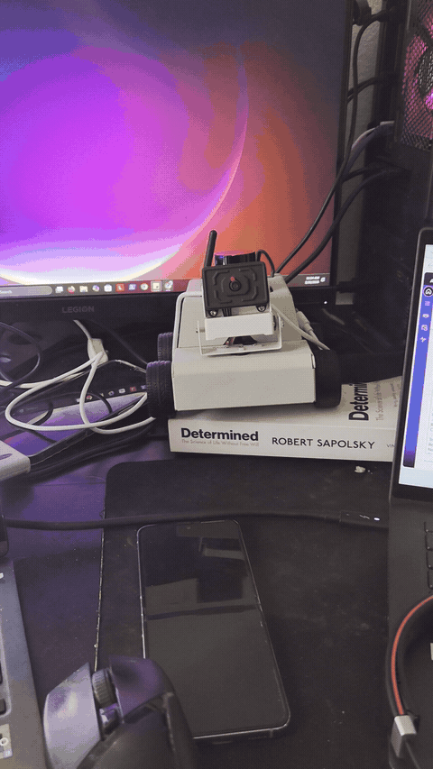

# rosbot-object-tracking-control

A ROS 2 control node that keeps a camera pointed at a tracked target, and hands off to base rotation when the target moves beyond the camera's reach.

The perception comes from Yahboom's vendor tracking package. The control does not. The vendor code drives the pan/tilt servos directly from inside its detection loop, so there is no way to change how the robot responds without editing the detector. I disabled that path, modified the tracker to publish tracking error as ROS 2 topics, and wrote a C++ node that consumes the error and decides what to move.

## Demo



The pan and tilt servos correct toward the target as it moves across the frame, including when it leaves the initial field of view.

---

## Why split perception from control

The vendor package detects a face or object and immediately writes servo angles. That couples three separate concerns: *where the target is*, *how far off-center it is*, and *what to do about it*.

Publishing error as a message breaks that coupling:

- **The control law is tunable without touching the detector.** Every gain, zone threshold, and limit is a declared ROS 2 parameter on one node.
- **The controller is testable without hardware.** Error values can be published by hand to exercise the control logic with no camera and no target.
- **The detector is swappable.** Any perception source publishing the same topics drives the same controller.

## Interface

The modified tracker publishes:

| Topic | Type | Meaning |
|---|---|---|
| `/tracker/target_found` | `Bool` | Target currently detected |
| `/tracker/target_x`, `/tracker/target_y` | `Float32` | Target centroid in image coordinates |
| `/tracker/error_x`, `/tracker/error_y` | `Float32` | Pixel offset from frame center (640x480, so `point_x - 320`) |

The controller publishes:

| Topic | Type | Meaning |
|---|---|---|
| `/servo_s1` | `Int32` | Pan angle, degrees |
| `/servo_s2` | `Int32` | Tilt angle, degrees |
| `/cmd_vel` | `Twist` | Base yaw rate |

---

## Control design

The camera servos and the drive base both reduce the same error, but they are not interchangeable:

| | Pan/tilt servos | Base yaw |
|---|---|---|
| Speed | Fast | Slow |
| Range | Limited by servo travel | Unlimited |
| Cost of moving | None, the robot stays put | The whole robot turns |

So the controller prefers the camera and falls back to the base, using three zones on the normalized horizontal error:

```
|error| < 0.15        deadzone      do nothing (prevents servo jitter)
0.15 .. 0.60          servo mode    pan/tilt only, base held at zero
|error| >= 0.60       base mode     rotate base, recenter camera
```

### The handoff

Moving both actuators at once fights itself: base rotation changes the camera's view, which changes the error, which moves the servos, which does nothing to the actual geometry. Two things prevent that.

**The base only engages at the edge zone**, where the camera is running out of useful travel. Below that threshold the base is held at zero.

**The camera recenters while the base turns.** During base mode the controller walks `servo1` back toward center one degree per tick, so by the time the base has brought the target back into view the camera has travel left in both directions:

```cpp
// While base turns, gently pull servo1 back toward center (prevents hitting servo limits)
if (servo1_ > s1_center) servo1_ -= static_cast<int>(pull);
if (servo1_ < s1_center) servo1_ += static_cast<int>(pull);
```

### Other control details

- **EMA smoothing** (`ema_alpha = 0.35`) on both error axes, so detector noise does not translate into servo chatter.
- **Step clamping** (`servo_max_step_deg = 0.4`) with gain scaled by error magnitude, so corrections are gentle near center and firmer at the edges.
- **Lost-target timeout** (`lost_timeout_sec = 0.35`). If the target has not been seen recently, base motion stops and the servos hold position rather than drifting.
- **Minimum turn rate** (`base_turn_min = 0.06` rad/s) so commanded yaw is never too small to overcome stiction.
- **Fixed-rate control loop** at 20 Hz, decoupled from the detector's frame rate.

All of the above are ROS 2 parameters, overridable at launch.

---

## What is mine and what is not

| Component | Source |
|---|---|
| Object, face, color, and QR detection; camera pipeline; micro-ROS transport | Yahboom vendor packages (`yahboom_esp32ai_car`, `yahboom_esp32_camera`, `yahboomcar_msgs`) |
| Modification to `mono_Tracker.py`: publish tracking error, disable direct servo control | Mine |
| `rosbot_tracking_controller` package and `ptz_base_controller.cpp` | Mine |
| micro-ROS agent startup scripts | Mine |

Vendor code is included so the system runs end to end. The contribution is the control layer and the interface change that made it possible.

---

## Running it

Requires ROS 2 Jazzy, Docker, and a Yahboom ESP32 robot with a pan/tilt camera mount.

**1. Start the micro-ROS agents** (base on UDP 8090, camera on UDP 9999):

```bash
./scripts/start_agents.sh
```

**2. Build:**

```bash
cd ros2_ws
colcon build --symlink-install
source install/setup.bash
```

**3. Run the tracker and the controller** in separate terminals:

```bash
ros2 run yahboom_esp32ai_car mono_Tracker
```

```bash
ros2 run rosbot_tracking_controller ptz_base_controller
```

**4. Inspect the interface while it runs:**

```bash
ros2 topic echo /tracker/error_x
ros2 topic echo /cmd_vel
```

Stop the agents with `./scripts/stop_agents.sh`.

### Testing the controller without a camera

Because the controller only consumes topics, it can be driven by hand. With the controller running and no tracker:

```bash
# Report a target found
ros2 topic pub -r 10 /tracker/target_found std_msgs/msg/Bool "{data: true}"

# Hold the target far right (edge zone) to trigger base mode
ros2 topic pub -r 10 /tracker/error_x std_msgs/msg/Float32 "{data: 250.0}"
ros2 topic pub -r 10 /tracker/error_y std_msgs/msg/Float32 "{data: 0.0}"
```

Watch `/cmd_vel` and `/servo_s1` respond. Drop `error_x` to `50.0` to fall back into servo mode.

### Tuning

```bash
ros2 run rosbot_tracking_controller ptz_base_controller --ros-args \
  -p outer_zone:=0.5 -p base_turn_kp:=0.6 -p ema_alpha:=0.5
```

---

## Limitations

- **Base yaw sign is robot-dependent.** The turn direction may need inverting for a given drive configuration; this is a sign flip on `wz`.
- **The zone boundary is a hard threshold, not a blend.** The base engages abruptly at `outer_zone`, and a target hovering near that boundary can cause the controller to alternate between modes.
- **Servo recentering can dither.** The pull toward center is a fixed one-degree step, so a servo sitting within one degree of center oscillates around it during base mode.
- **Gains are fixed with respect to target distance.** Tracking is tuned for one working range; a target twice as far produces half the pixel error for the same angular offset.
- **No re-acquisition strategy.** When the target is lost the robot holds position rather than searching.
- **No automated tests.** Behavior was verified on hardware and by publishing synthetic error values.